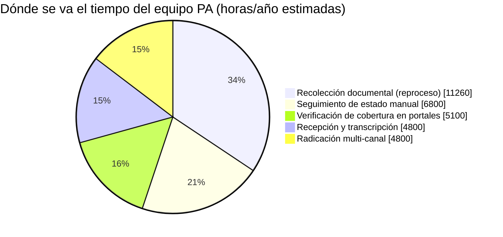
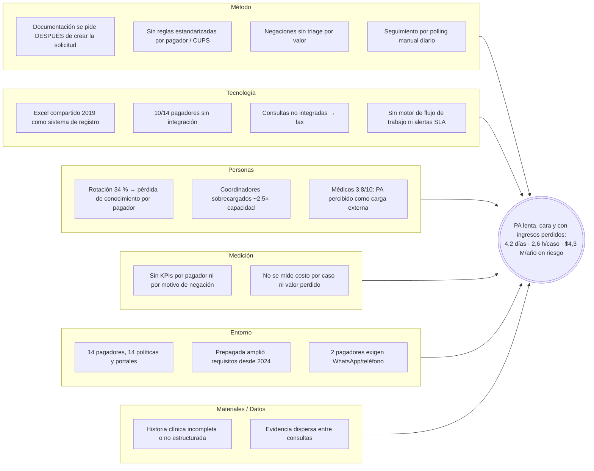

# 01 · Análisis del caso — Autorización previa (PA) en Niágara en Bicicleta

> Fuente: *"Organización de Salud Niágara en bicicleta: el cuello de botella de la autorización de servicios médicos"* (caso ficticio, proyecto de curso).
> Todas las cifras en USD salvo indicación. Los supuestos propios se marcan con **[S]**.

---

## 1. Objetivo del proceso (entregable 1)

**La autorización previa existe para que un paciente reciba, en el menor tiempo clínicamente adecuado, un servicio que es médicamente necesario y que el pagador se compromete a pagar.**

Desglosado, el proceso debe garantizar tres cosas a la vez:

| Para quién | Qué debe lograr el proceso | Cómo se mide |
|---|---|---|
| **Paciente** | Acceso oportuno al servicio correcto, sin quedar atrapado entre el médico y la EPS | Días hasta el servicio, % de abandono |
| **Pagador (EPS/Prepagada/Sisbén)** | Evidencia de que el servicio es médicamente necesario y está cubierto **antes** de comprometer el gasto | % aprobación en primera radicación |
| **Niágara (prestador)** | Garantía de pago por el servicio prestado (ingreso asegurado) con el menor costo administrativo posible | Costo por autorización, ingresos perdidos por negación/abandono |

**Lo que el proceso NO es (aunque hoy lo parezca):** un trámite para demostrar que los formularios se llenaron bien. Hoy el 61 % del tiempo del equipo se va en tareas sin juicio clínico; el valor real —la decisión de necesidad médica— ocupa la minoría del esfuerzo.

> **Definición operativa del producto del proceso:** *una decisión de cobertura (aprobación o negación fundamentada) obtenida con un expediente clínico completo, en ≤ 2 días hábiles, al menor costo por caso, y con toda negación evaluable revisada.*

---

## 2. Datos base del caso

| Variable | Valor | Derivado |
|---|---|---|
| Solicitudes / mes | 2.400 | **28.800 / año** |
| Equipo PA | 14 coordinadores + 3 líderes + 1 responsable = **18** | Costo laboral **$2,48 M/año** |
| Pagadores | 14 (solo **4** integrados) | 10 requieren portal manual / teléfono |
| Tiempo coordinador por solicitud | **2,6 h** (referencia 0,8–1,2 h) | 2,2–3,3× sobre el benchmark |
| Días hasta decisión | **4,2 días hábiles** (ref. 1–2) | |
| Retraso medio del paciente | **6,1 días hábiles** | |
| % con seguimiento documental | **68 %** · 2,3 contactos/solicitud | |
| % con login manual a portal | **71 %** | |
| % tiempo sin juicio clínico | **~61 %** | |
| Tasa de negación inicial | **18,4 %** (rango 9 %–31 % por pagador) | ≈ 5.299 negaciones/año |
| Negaciones apeladas | **41 %** (éxito 31 %) | 59 % abandonadas |
| Abandono de pacientes | **3,8 %** | ≈ 1.095 pacientes/año |
| Rotación de coordinadores | **34 %/año** | ≈ 4,8 personas/año |
| Satisfacción médica con PA | **3,8 / 10** | |
| Volumen vs. costo (3 años) | +22 % volumen / **+30 % costo** | El costo crece más rápido que el volumen |

### 2.1 Inconsistencias detectadas en los datos (y cómo las tratamos)

Un análisis riguroso debe señalar dónde los números no cierran:

1. **Capacidad imposible.** 170 solicitudes/mes × 2,6 h = **442 h/mes por coordinador**, ~2,5× una jornada completa (≈176 h). O bien las 2,6 h incluyen tiempos de espera (teléfono en espera, portales lentos), o existe un **backlog oculto / horas extra** que explica la rotación del 34 %. → *Lo tratamos como evidencia de que el proceso opera por encima de su capacidad: la cola crece y los días de espera son consecuencia directa.*
2. **Ingresos en riesgo por negaciones no apeladas.** El caso dice ~$3,2 M. Con las tasas del caso: 5.299 × 59 % = 3.126 negaciones × $620 = **$1,94 M**. Los $3,2 M ≈ 5.161 × $620, es decir, se acerca al total de negaciones. → *Usamos el cálculo directo ($1,94 M bruto) para el escenario base y los $3,2 M como techo.*
3. **Ingresos recuperados por apelación.** El caso dice ~$540 k; el cálculo directo da 5.299 × 41 % × 31 % = 674 casos × $620 = **$418 k**. → *Usamos $418 k para mantener consistencia interna.*
4. **Unidades.** "Ingresos netos de 4.000 millones de pesos" (~$1 M USD) es incompatible con un equipo PA de $2,48 M USD. → *Asumimos que todo el análisis financiero está en USD y que la cifra de ingresos totales es un error de unidades; no la usamos.*

---

## 3. El problema (entregable 2)

**Enunciado:** *Niágara gestiona la autorización previa como un trabajo artesanal de coordinación —portal por portal, llamada por llamada, en un Excel compartido— sin un sistema de flujo de trabajo, sin documentación completa en origen y sin capacidad para pelear las negaciones. El resultado es un proceso que cuesta 2–3× el benchmark, tarda 2–4× más, pierde ~$4,3 M/año en ingresos y deja ~1.100 pacientes/año sin atención.*

### 3.1 Cuellos de botella (dónde se pierde el tiempo)

Estimación del tiempo y costo por etapa. Costo hora del equipo = $2,48 M / (18 × 1.800 h) ≈ **$76,5/h [S]**.

| # | Etapa AS-IS | Cuello de botella | Volumen anual afectado | Horas/año estimadas | Costo/año | Tipo |
|---|---|---|---|---|---|---|
| 1 | Recepción | Órdenes por **fax y teléfono** desde consultas no integradas; transcripción manual a Excel | 28.800 | ~4.800 (10 min/sol) **[S]** | ~$367 k | Sin valor |
| 2 | Verificar cobertura | **10 de 14 pagadores** sin integración: login portal o llamada | 20.448 (71 %) | ~5.100 (15 min) **[S]** | ~$391 k | Sin valor |
| 3 | **Recolectar documentación** | **Principal cuello de botella**: 68 % requiere seguimiento, 2,3 contactos c/u | 19.584 → 45.043 contactos | ~11.260 (15 min/contacto) **[S]** | **~$861 k** | Reproceso |
| 4 | Radicar | 14 formatos distintos; fax y **WhatsApp** para 2 pagadores | 28.800 | ~4.800 (10 min) **[S]** | ~$367 k | Sin valor |
| 5 | Seguimiento de estado | Consulta **manual diaria** del portal durante 4,2 días | 20.448 | ~6.800 (4 consultas × 5 min) **[S]** | ~$521 k | Sin valor |
| 6 | Gestionar negaciones | Sin tiempo: **59 % se abandona** | 5.299 | — | ver §3.3 | Pérdida de ingreso |
| 7 | Tutela | Recae en el **paciente**; 31 % de éxito | 2.173 | — | — | Riesgo legal/reputacional |

> **Total de horas sin juicio clínico estimadas: ~32.760 h/año ≈ $2,5 M** — coincide con el orden de magnitud del costo laboral total, confirmando que el equipo vive en trabajo transaccional y que el dato de **61 %** es incluso conservador.

### 3.2 Análisis de causas

#### Diagrama de Ishikawa (6M adaptado)

#### 5 Porqués sobre el cuello de botella principal (documentación)

1. **¿Por qué tarda 4,2 días la decisión?** Porque el 68 % de las solicitudes queda esperando documentación.
2. **¿Por qué falta documentación?** Porque el coordinador la solicita *después* de que el médico creó la orden, por teléfono, a una consulta que ya pasó a otro paciente.
3. **¿Por qué el médico no la adjunta al crear la orden?** Porque al ordenar no sabe qué exige cada uno de los 14 pagadores para ese procedimiento.
4. **¿Por qué no lo sabe?** Porque las reglas de cada pagador viven en la cabeza de los coordinadores (con 34 % de rotación) y en un Excel, no en el sistema donde se ordena.
5. **¿Por qué?** Porque nunca se modeló el proceso de PA como un sistema: **las reglas de negocio no están codificadas ni ubicadas en el punto de origen (la orden médica)**.

> **Causa raíz #1:** la calidad del expediente se verifica al final del proceso (inspección) en lugar de construirse al inicio (calidad en la fuente / *jidoka*).
> **Causa raíz #2:** ausencia de una plataforma de flujo de trabajo con conocimiento codificado de pagadores → todo el trabajo es manual, no medible y dependiente de personas.
> **Causa raíz #3:** las negaciones se tratan como un evento final y no como un inventario con valor económico → el 59 % se pierde por falta de tiempo, no por falta de mérito.

### 3.3 Costo de la ineficiencia (AS-IS)

| Ineficiencia | Cálculo | Costo anual |
|---|---|---|
| Trabajo sin juicio clínico | 61 % × $2,48 M | **$1,51 M** |
| Exceso sobre benchmark de tiempo | (2,6 − 1,0) / 2,6 = 61,5 % del esfuerzo | ≈ $1,53 M (coincide) |
| Ingresos perdidos por negaciones (no apeladas + apeladas perdidas) | (5.299 − 674) × $620 | **$2,87 M** |
| — de los cuales: no apeladas | 3.126 × $620 | $1,94 M (caso: $3,2 M) |
| Ingresos perdidos por abandono de pacientes | 1.095 × ~$1.005 | **$1,10 M** |
| Rotación de coordinadores | 4,8 × 40 % × $120 k **[S]** | **$0,23 M** |
| Costo laboral por solicitud | $2,48 M / 28.800 | **$86 / solicitud** |
| **Total de valor perdido o mal invertido** | | **≈ $5,7 M/año** |

**Tendencia que hace urgente la decisión:** volumen +22 % y costo +30 % en 3 años → el costo unitario crece ~6,5 %. Con el modelo actual, sostener el crecimiento exige contratar en proporción al volumen, lo que contradice directamente el plan estratégico (*"ampliar capacidad de especialistas sin crecimiento administrativo proporcional"* y *"reducir costos no clínicos 12 %"*).

---

## 4. Calidad del servicio: brechas

| Dimensión de calidad | AS-IS | Brecha principal | Palanca en el TO-BE |
|---|---|---|---|
| **Oportunidad** (paciente) | 6,1 días de espera, 3,8 % abandona | 3–4 días sobre benchmark | Expediente completo en origen + radicación automática + monitoreo por eventos |
| **Efectividad** (decisión correcta) | 18,4 % negación inicial; 9 %–31 % según pagador | Variabilidad = falta de estandarización | Checklist por pagador/CUPS + puntaje de completitud antes de radicar |
| **Equidad** | La tutela la prepara el **paciente** | La carga legal recae en el más vulnerable | Niágara arma el expediente de apelación/tutela |
| **Experiencia del médico** | 3,8 / 10 | Llamadas interruptivas | Una sola interacción, dentro de la HCE, en el momento de ordenar |
| **Experiencia del equipo** | 34 % rotación | Trabajo repetitivo, sobrecarga | Bandeja de excepciones, trabajo de juicio clínico |
| **Trazabilidad** | Excel compartido | Sin auditoría, sin métricas | Event log inmutable por caso + tablero en tiempo real |

---

## 5. Respuesta a las preguntas del caso

**1. ¿Cómo sería un proceso donde la documentación esté completa antes de radicar?**
Moviendo la verificación al momento de la orden: cuando el médico ordena un CUPS para un paciente de un pagador X, el sistema ya conoce las reglas de X para ese CUPS, **extrae automáticamente** de la HCE la evidencia existente (notas, resultados, tratamientos previos) con IA, calcula un **puntaje de completitud** y le pide al médico *solo lo que falta*, en la misma pantalla. Nada se radica con puntaje < 100 %. El seguimiento documental pasa de 68 % a < 15 % y los 2,3 contactos telefónicos desaparecen.

**2. ¿Cómo pensar la brecha del 59 % de negaciones no revisadas?**
Como **un inventario de ingresos con valor esperado**, no como un trámite. Cada negación tiene un valor esperado = *P(revocación) × monto*. Con la clasificación automática del motivo de negación, la IA redacta el borrador de apelación con la evidencia ya estructurada, y el equipo (ahora con 60 % de tiempo liberado) revisa en orden de valor esperado. Un **equipo de apelaciones** dedicado (3 coordinadores reasignados) cierra la brecha. Además, cada negación alimenta el motor de reglas → la siguiente solicitud ya no comete el mismo error (ciclo de aprendizaje).

**3. ¿Un proceso que sirva mejor al propósito original (necesidad médica)?**
Sí: separar **lo administrativo** (elegibilidad, formatos, radicación, seguimiento → 100 % automatizable) de **lo clínico** (¿está justificada la necesidad médica? → juicio humano asistido por IA). El coordinador deja de ser "digitador de portales" y pasa a ser **gestor clínico de excepciones**: revisa solo los casos con puntaje de necesidad bajo, alto costo o alta probabilidad de negación. Y con datos de aprobación por médico/pagador, Niágara puede negociar con los pagadores **programas de "gold-carding"** (exención de PA para médicos con > 90 % de aprobación), atacando la causa estructural del lado del pagador.

---

➡️ Continúa en [02-bpm.md](02-bpm.md) (proceso AS-IS / TO-BE).
