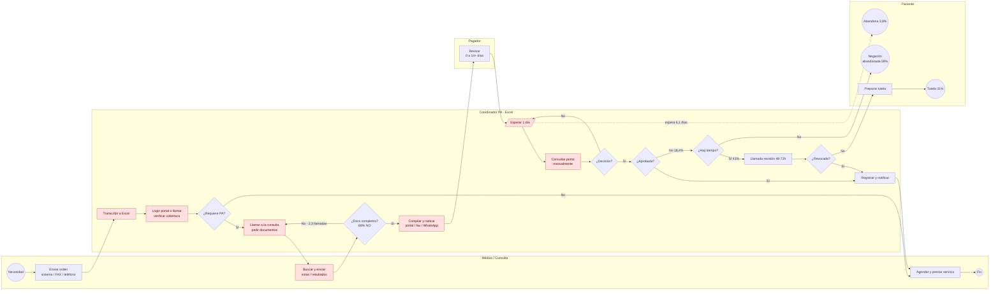
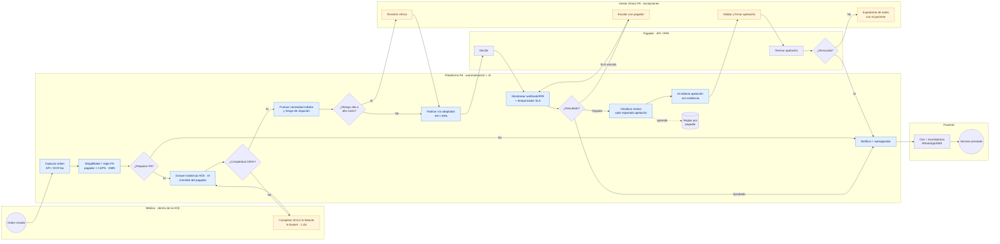

# 02 · Gestión por procesos (BPM): AS-IS → TO-BE

> Diagramas BPMN 2.0 editables: [`bpmn/as-is.bpmn`](bpmn/as-is.bpmn) y [`bpmn/to-be.bpmn`](bpmn/to-be.bpmn) (abrir en [Camunda Modeler](https://camunda.com/download/modeler/) o [demo.bpmn.io](https://demo.bpmn.io)). Se regeneran con `python3 docs/bpmn/generar_bpmn.py`.
> También se pueden ver dentro del MVP en la sección **Proceso**.

---

## 1. Formato de rediseño (plantilla del curso)

| Bloque | Contenido |
|---|---|
| **¿Qué activa el proceso?** | Una **orden médica** (remisión a especialista, procedimiento, imagen, medicamento) para un paciente cuyo pagador exige autorización previa para ese CUPS. |
| **Reglas de negocio** | R1. Cada pagador × CUPS × plan define si requiere PA y qué evidencia exige. R2. No se radica una solicitud con completitud < 100 %. R3. Toda solicitud tiene SLA: decisión ≤ 2 días hábiles (urgentes ≤ 24 h). R4. Toda negación se clasifica y se apela si *valor esperado = P(revocar) × monto* > umbral. R5. Llamada de revisión ≤ 48–72 h desde la negación. R6. Datos clínicos tratados según Ley 1581/2012 (habeas data) y normatividad de historia clínica (Res. 1995/1999). R7. Toda acción queda en bitácora auditable. |
| **Requerimiento → Transformación → Entrega** | *Requerimiento:* orden + datos del paciente + pagador. *Transformación:* verificación de elegibilidad, construcción del expediente clínico completo, evaluación de necesidad, radicación, seguimiento, gestión de negación. *Entrega:* decisión de cobertura + cita agendada (o expediente de apelación/tutela). |
| **Recursos** | Plataforma PA (motor de flujo, motor de reglas, IA de extracción, adaptadores API/RPA por pagador), HCE, Sistema de Citas, 6 gestores clínicos PA + 3 en unidad de apelaciones (14 → 9 coordinadores por no reemplazo de rotación) + 3 líderes + 1 responsable, catálogo de reglas por pagador. |
| **¿Qué entrego?** | Autorización aprobada y cita agendada; o negación fundamentada con apelación radicada. |
| **¿A quién? / ¿Qué valora?** | **Paciente**: rapidez, certeza, no hacer trámites. **Médico**: no ser interrumpido, saber qué se necesita al ordenar. **Pagador**: expediente completo y correcto la primera vez. **Niágara (finanzas)**: ingreso asegurado, bajo costo por caso. |
| **¿Cómo lo ejecutamos hoy? (AS-IS)** | 7 etapas manuales: orden por sistema/fax/teléfono → login a portal o llamada → llamadas para pedir documentos (2,3 por caso) → radicación por portal/fax/WhatsApp → consulta diaria de estado → registro de decisión → tutela preparada por el paciente. Registro en Excel compartido. |
| **Desempeño AS-IS** | 2,6 h/caso · 4,2 días a decisión · 6,1 días de espera paciente · 18,4 % negación · 59 % negaciones abandonadas · 3,8 % abandono · 34 % rotación · 3,8/10 satisfacción médica · $86/caso. |
| **¿Cómo deberíamos ejecutarlo? (TO-BE)** | Orden en HCE → la plataforma captura, verifica elegibilidad y reglas, extrae evidencia con IA y pide al médico solo lo faltante → puntúa necesidad y riesgo → radica automáticamente (API/RPA) → monitorea por eventos con SLA → aprobada: autoagenda; negada: clasifica, prioriza por valor, IA redacta apelación, humano valida. Personas solo en excepciones. |
| **Desempeño TO-BE esperado** | ≤ 1,0 h/caso · ≤ 1,5 días a decisión · ≤ 2,5 días espera · ≤ 11 % negación · ≥ 85 % negaciones evaluables apeladas · ≤ 1,5 % abandono · ≤ 20 % rotación · ≥ 7/10 satisfacción · ≤ $45/caso. |
| **Consideraciones y herramientas** | BPMN 2.0 + motor de workflow (Camunda 8 / Temporal), DMN para reglas por pagador, IA (LLM + OCR) con humano en el ciclo, RPA para portales sin API, HL7 FHIR para integración con HCE, tablero de KPIs, gestión del cambio, negociación de *gold-carding* con pagadores. Ver [05-valor-riesgos-consideraciones.md](05-valor-riesgos-consideraciones.md). |

---

## 2. SIPOC

| Proveedores | Entradas | Proceso (macro) | Salidas | Clientes |
|---|---|---|---|---|
| Médicos y consultas (22 + 3 hospitales) | Orden médica (CUPS, CIE-10) | 1. Capturar orden | Caso PA creado | Paciente |
| HCE / laboratorio / imágenes | Notas, resultados, tratamientos previos | 2. Verificar elegibilidad y reglas | Expediente clínico completo | Médico tratante |
| 14 pagadores | Políticas PA, portales, APIs | 3. Construir expediente | Decisión de cobertura | Pagador |
| Paciente | Datos de afiliación, consentimiento | 4. Radicar y monitorear | Cita agendada | Finanzas / Facturación |
| | | 5. Gestionar decisión / apelar | Apelación / expediente de tutela | Dirección (KPIs) |

---

## 3. AS-IS — Proceso actual

*En rojo: actividades sin valor agregado (transcripción, navegación, reproceso, espera).*

### 3.1 Análisis de valor agregado (VA / VAN / NVA)

| Actividad AS-IS | Clasificación | Justificación |
|---|---|---|
| Enviar orden por fax/teléfono | NVA | Canal manual; la orden ya existe en otro sistema |
| Transcribir a Excel | NVA | Doble digitación, sin trazabilidad |
| Verificar cobertura en portal/llamada | VAN (necesaria) | Necesaria, pero 100 % automatizable |
| Pedir documentos por teléfono (×2,3) | NVA – reproceso | Defecto de calidad en origen |
| Juzgar si la evidencia soporta la necesidad | **VA** | Único paso con juicio clínico |
| Radicar por portal/fax/WhatsApp | VAN | Necesaria, automatizable |
| Consultar estado diario | NVA | Espera + polling manual |
| Gestionar negación / apelar | **VA** | Recupera ingreso y acceso |

**Eficiencia del ciclo AS-IS** ≈ tiempo VA / tiempo total ≈ (~0,5 h de juicio clínico) / (4,2 días hábiles ≈ 34 h) ≈ **1,5 %**.

---

## 4. TO-BE — Proceso rediseñado (entregable 3)

### 4.1 Principios de diseño del nuevo proceso

1. **Calidad en la fuente:** el expediente se construye completo en el momento de la orden, no se persigue después.
2. **Toca una vez (*touch once*):** el médico interactúa una sola vez, dentro de su HCE, solo si falta algo.
3. **Sin intervención humana en lo administrativo** (elegibilidad, formato, radicación, seguimiento) → *straight-through processing*.
4. **Humanos en el juicio clínico y las excepciones** (riesgo alto, alto costo, apelaciones).
5. **Las negaciones son un inventario con valor** y alimentan el aprendizaje del motor de reglas.
6. **Todo medible:** cada paso emite eventos → KPIs por pagador, CUPS, médico y motivo.

### 4.2 Diagrama TO-BE

*Azul: automático. Amarillo: juicio humano.*

### 4.3 Descripción de principio a fin

| # | Actividad TO-BE | Actor | Automatización / estandarización | Reemplaza AS-IS |
|---|---|---|---|---|
| 1 | **Capturar orden**: la orden en HCE emite evento (HL7 FHIR `ServiceRequest`); las consultas no integradas envían fax → OCR + IA lo convierte en solicitud estructurada. | Plataforma | Integración HCE, OCR, normalización CUPS/CIE-10 | Etapa 1 + transcripción a Excel |
| 2 | **Verificar elegibilidad y regla PA**: consulta automática de derechos (API/RPA) y tabla de decisión DMN `pagador × plan × CUPS → requiere PA, evidencia exigida, SLA`. | Plataforma | Motor de reglas, adaptadores | Etapa 2 (login/llamada) |
| 3 | **Construir expediente**: IA extrae de la HCE notas, resultados y tratamientos previos y los mapea al checklist del pagador; calcula % de completitud. | Plataforma | LLM + RAG sobre HCE, checklist estandarizado | Etapa 3 (llamadas) |
| 4 | **Completar faltantes**: si < 100 %, el médico recibe en su bandeja de la HCE *exactamente* qué falta, con texto sugerido. | Médico | Formulario dinámico | 2,3 llamadas por caso |
| 5 | **Evaluar necesidad y riesgo**: puntaje de probabilidad de aprobación (histórico pagador/CUPS/motivo) y criterio clínico (guías). Casos de riesgo alto o alto costo → revisión humana. | Plataforma + gestor clínico | Modelo de scoring, cola de excepciones | Revisión informal |
| 6 | **Radicar**: el adaptador del pagador transforma el expediente al formato del pagador y radica por API; si no hay API, por bot RPA; WhatsApp vía API Business con plantilla. Idempotente. | Plataforma | Adapter por pagador, RPA, circuit breaker | Etapa 4 |
| 7 | **Monitorear**: webhooks o polling automático por bot; temporizador SLA escala a humano si vence. | Plataforma | Eventos + timers BPMN | Etapa 5 (consulta diaria) |
| 8a | **Aprobada**: se registra la autorización, se notifica al médico y se **autoagenda**; paciente recibe cita y recordatorios. | Plataforma | Integración Sistema de Citas, mensajería | Etapa 6 |
| 8b | **Negada**: se clasifica el motivo, se calcula valor esperado de apelar; si supera el umbral, IA redacta apelación con la evidencia; gestor clínico valida y firma; llamada de revisión agendada automáticamente dentro de 48 h. | Plataforma + gestor | Clasificador, LLM, agenda | Etapa 6 (59 % abandonadas) |
| 9 | **Tutela acompañada**: si la apelación falla y hay mérito, Niágara arma el expediente con el paciente. | Gestor clínico | Plantilla + expediente completo | Etapa 7 (paciente solo) |
| 10 | **Aprender**: cada negación y su motivo actualizan reglas y checklist del pagador (versión nueva de la tabla DMN, aprobada por líder). | Líder PA | Ciclo de mejora continua | No existe |

### 4.4 Indicadores AS-IS vs TO-BE

| KPI | AS-IS | Meta TO-BE (12 meses) | Fuente del dato TO-BE |
|---|---|---|---|
| Tiempo de gestor por solicitud | 2,6 h | **≤ 1,0 h** | Eventos del workflow |
| Días hábiles hasta decisión | 4,2 | **≤ 1,5** | `submitted_at → decided_at` |
| Espera del paciente | 6,1 días | **≤ 2,5 días** | `ordered_at → scheduled_at` |
| % con seguimiento documental | 68 % | **≤ 15 %** | Casos con tarea M1 |
| % radicación manual | 71 % | **≤ 20 %** | Canal de radicación |
| % procesamiento sin intervención humana (STP) | ~0 % | **≥ 60 %** | Casos sin tareas humanas |
| Tasa de negación inicial | 18,4 % | **≤ 11 %** | Decisiones |
| % negaciones evaluables apeladas | 41 % | **≥ 85 %** | Apelaciones / negaciones |
| Éxito de apelación | 31 % | **≥ 35 %** | Revocaciones |
| Abandono de pacientes | 3,8 % | **≤ 1,5 %** | Órdenes sin servicio a 30 días |
| Rotación coordinadores | 34 % | **≤ 20 %** | RR. HH. |
| Satisfacción médica | 3,8 / 10 | **≥ 7 / 10** | Encuesta trimestral |
| Costo laboral por solicitud | $86 | **≤ $45** | Costo equipo / volumen |

---

## 5. Papel de la estandarización y la automatización (entregable 4)

| Nivel | Qué se estandariza / automatiza | Qué hace específicamente | Dónde |
|---|---|---|---|
| **Estandarización de datos** | Solicitud canónica (FHIR `ServiceRequest` + `Claim` preauth), códigos CUPS/CIE-10, motivos de negación catalogados | Un solo modelo interno para 14 pagadores; los adaptadores traducen | Pasos 1, 6 |
| **Estandarización de reglas** | Tabla DMN por pagador × CUPS × plan; checklist de evidencia por regla | Saca el conocimiento de la cabeza de los coordinadores (rotación 34 %) y lo hace versionable | Pasos 2, 3, 10 |
| **Estandarización del trabajo** | Un solo flujo BPMN, bandejas por rol, SLA por tipo | Elimina el Excel; todos trabajan igual; todo se mide | Todo el proceso |
| **Automatización de reglas (BRMS)** | Elegibilidad, ¿requiere PA?, prioridad, umbral de apelación | Decisiones deterministas en milisegundos | Pasos 2, 5, 8b |
| **Integración (API / FHIR)** | HCE, Sistema de Citas, 4 pagadores integrados (+ los que publiquen API) | Elimina digitación y portales | Pasos 1, 6, 7, 8a |
| **RPA** | 10 portales sin API, consulta de estado | Bots radican y consultan como lo haría un humano, 24/7 | Pasos 2, 6, 7 |
| **IA documental (OCR + LLM)** | Fax → solicitud; HCE → evidencia mapeada al checklist | Elimina el principal cuello de botella (llamadas por documentos) | Pasos 1, 3 |
| **IA analítica** | Scoring de probabilidad de aprobación y de revocación | Prioriza el trabajo humano donde hay más valor | Pasos 5, 8b |
| **IA generativa** | Borradores de apelación y de tutela citando evidencia | Convierte 59 % abandonado en apelaciones viables | Paso 8b, 9 |
| **Orquestación (workflow + eventos)** | Timers SLA, escalamiento, reintentos | Nada queda olvidado en una cola | Pasos 7, 8 |

**Lo que NO se automatiza:** la decisión clínica final sobre la necesidad médica en casos complejos, la firma de apelaciones y la relación con el paciente en tutela. La IA *propone*, el humano *dispone*.

---

➡️ Continúa en [03-pipelines.md](03-pipelines.md).
