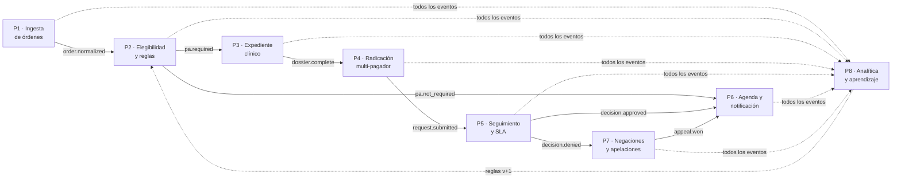
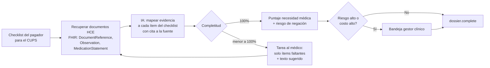
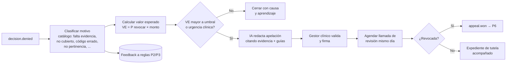
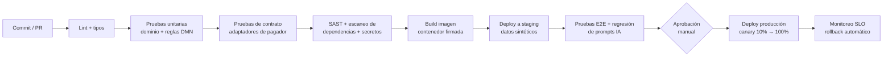

# 03 · Pipelines de automatización

El proceso TO-BE se implementa como **pipelines encadenados por eventos**. Cada pipeline sigue el estilo **Pipes & Filters**: filtros independientes, sin estado compartido, que reciben un mensaje, lo transforman/enriquecen y lo pasan al siguiente. Esto permite agregar, quitar o reordenar pasos (por ejemplo, un nuevo pagador) sin tocar el resto.

Convenciones comunes a todos los pipelines:

- **Mensaje**: sobre JSON con `case_id`, `event_id` (UUID, clave de idempotencia), `trace_id`, `payer_id`, `occurred_at`, `payload`.
- **Idempotencia**: cada filtro registra `event_id` procesados → un reintento nunca radica dos veces.
- **Error**: 3 reintentos con *backoff* exponencial + *jitter* → luego cola de mensajes muertos (DLQ) → tarea humana en la bandeja de excepciones.
- **Trazabilidad**: cada filtro publica un evento de dominio que queda en la bitácora del caso (auditoría).

---

## P1 · Ingesta de órdenes

| Filtro | Entrada | Salida | Tecnología |
|---|---|---|---|
| 1.1 Receptor multicanal | FHIR `ServiceRequest` (HCE), fax (PDF/TIFF), formulario web, correo | Documento crudo + canal | API REST, buzón de fax digital |
| 1.2 OCR | PDF/imagen | Texto + layout | Textract / Azure Document Intelligence / Tesseract |
| 1.3 Extracción IA | Texto | Campos: paciente, documento, CUPS, CIE-10, médico, urgencia | LLM con *structured output* + validación de esquema |
| 1.4 Normalización | Campos | Solicitud canónica (códigos validados contra catálogos CUPS / CIE-10) | Servicio de terminologías |
| 1.5 Deduplicación | Solicitud | Caso nuevo o vinculado | Hash (paciente + CUPS + fecha) |
| 1.6 Confianza | Solicitud + score | Si confianza < 0,9 → tarea humana de validación | Regla |

**Evento de salida:** `order.normalized`. **KPI:** % órdenes sin digitación humana (meta ≥ 95 %).

## P2 · Elegibilidad y reglas de PA

| Filtro | Qué hace |
|---|---|
| 2.1 Resolver pagador | Identifica EPS/Prepagada/Sisbén/particular por documento del paciente (caché 24 h) |
| 2.2 Consultar derechos | Adaptador del pagador: API (4 pagadores) o bot RPA (10) → afiliación activa, plan |
| 2.3 Motor de reglas (DMN) | `pagador × plan × CUPS → {requiere_pa, evidencia_requerida[], sla_horas, canal}` |
| 2.4 Priorización | Urgencia clínica + SLA → prioridad de cola |

**Eventos:** `pa.required` / `pa.not_required` / `eligibility.failed`. **KPI:** tiempo de elegibilidad < 2 min.

## P3 · Construcción del expediente clínico (el cuello de botella eliminado)

- Cada ítem del checklist guarda **la cita exacta** a la fuente en la HCE (documento, fecha, fragmento) → auditable y sin alucinaciones aceptadas.
- El puntaje de riesgo usa histórico por pagador/CUPS/motivo de negación (modelo de clasificación simple, explicable).
- **KPI:** % expedientes completos sin contacto humano (meta ≥ 85 %), tiempo medio de completitud.

## P4 · Radicación multi-pagador

| Filtro | Qué hace |
|---|---|
| 4.1 Selección de adaptador | *Factory* devuelve el adaptador del pagador (API, RPA, WhatsApp Business, fax saliente) |
| 4.2 Transformación | Expediente canónico → formato del pagador (formularios, anexos PDF firmados) |
| 4.3 Envío idempotente | `idempotency_key = case_id + intento`; *circuit breaker* por pagador |
| 4.4 Acuse | Guarda número de radicado del pagador + evidencia (captura/recibo) |

**Evento:** `request.submitted`. **KPI:** % radicado automático (meta ≥ 80 %).

## P5 · Seguimiento de estado y SLA

- **Push**: webhooks de pagadores integrados.
- **Pull**: bot de consulta programado por pagador (cada 2–4 h, ventana hábil), no "cada día a mano".
- **Temporizador SLA** (BPMN timer): al 80 % del SLA → alerta; al 100 % → tarea de escalamiento al gestor.

**Eventos:** `decision.approved` / `decision.denied` / `decision.info_requested` / `sla.breached`.

## P6 · Agenda y notificación

1. Registrar número de autorización y vigencia.
2. Autoagendar en el Sistema de Citas (primer cupo disponible del especialista).
3. Notificar a médico (HCE) y paciente (WhatsApp/SMS/correo) con recordatorios a −72 h y −24 h.
4. Si `info_requested`: volver a P3 con los ítems nuevos.

**KPI:** días orden → cita; % pacientes que abandonan.

## P7 · Negaciones y apelaciones

**KPI:** % negaciones evaluables apeladas (meta ≥ 85 %), tasa de revocación, $ recuperados.

## P8 · Analítica y aprendizaje (datos)

| Etapa | Qué hace |
|---|---|
| 8.1 Captura (CDC / eventos) | Todos los eventos de dominio → *data lake* (formato columnar) |
| 8.2 Modelo de datos | Hechos: casos, decisiones, apelaciones, tiempos por etapa. Dimensiones: pagador, CUPS, médico, sede |
| 8.3 Tablero | KPIs §4.4 en tiempo real; *ranking* de pagadores por negación y tiempo |
| 8.4 Reentrenamiento | Mensual: modelos de riesgo de negación y de revocación; validación con métricas y sesgo |
| 8.5 Propuesta de reglas | Motivos de negación recurrentes → propuesta de cambio en DMN/checklist → aprobación del líder PA → versión nueva |
| 8.6 Evidencia para pagadores | Reporte de tasa de aprobación por médico → negociación de *gold-carding* |

---

## P9 · Pipeline de entrega de software (CI/CD)

- **Pruebas de contrato por pagador**: cada adaptador tiene un *mock* del portal/API grabado; si el pagador cambia su portal, el bot RPA falla en staging antes que en producción.
- **Regresión de IA**: conjunto de 200 expedientes anonimizados con resultado esperado; un cambio de prompt o modelo no se despliega si la precisión de extracción baja > 2 pp.
- **Datos**: staging solo con datos sintéticos (Ley 1581 de 2012).

---

➡️ Continúa en [04-arquitectura.md](04-arquitectura.md).
