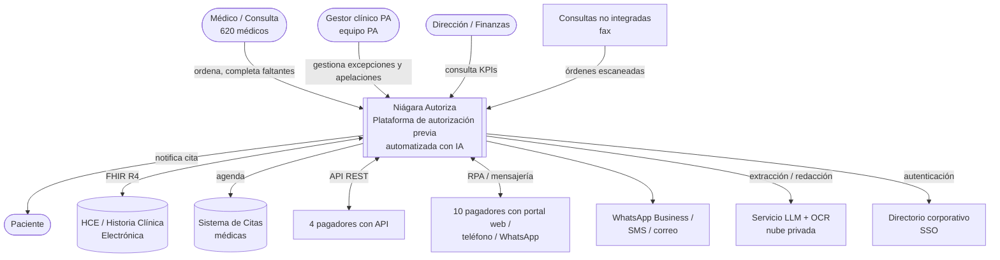
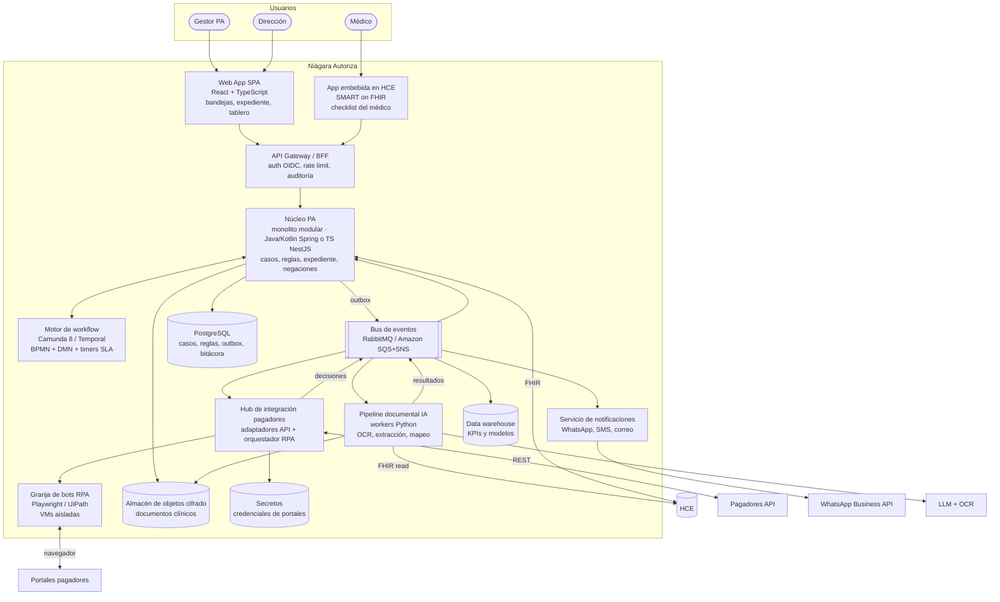
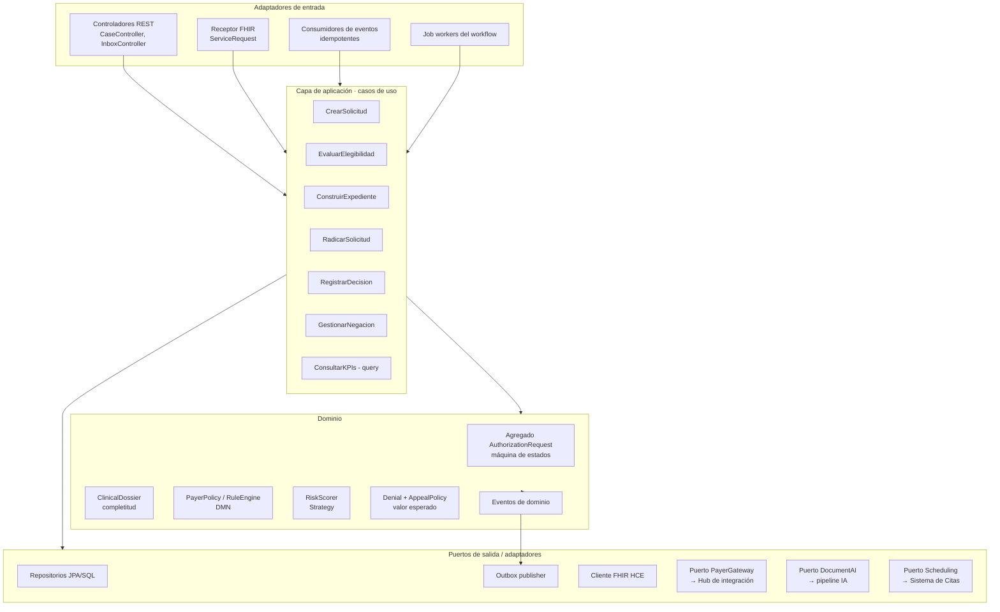
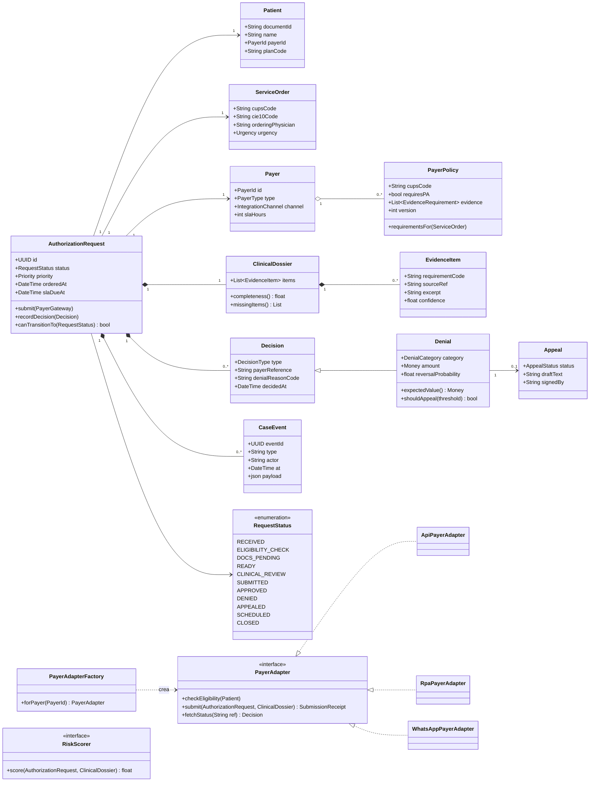
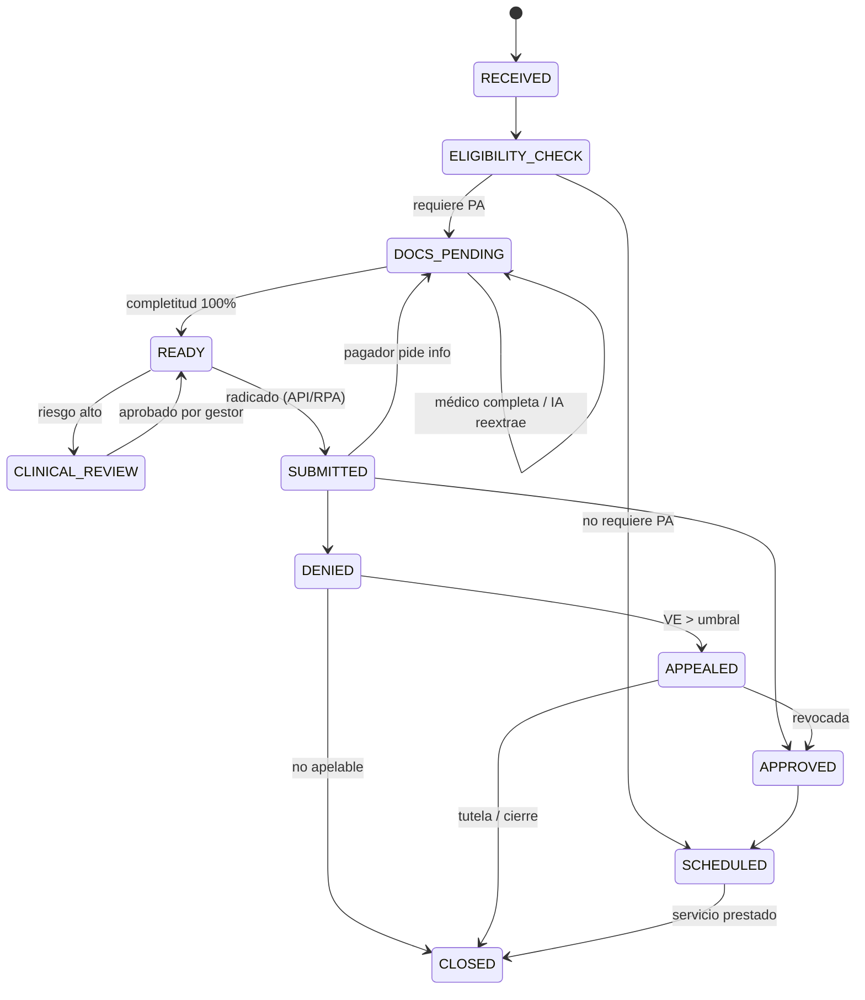
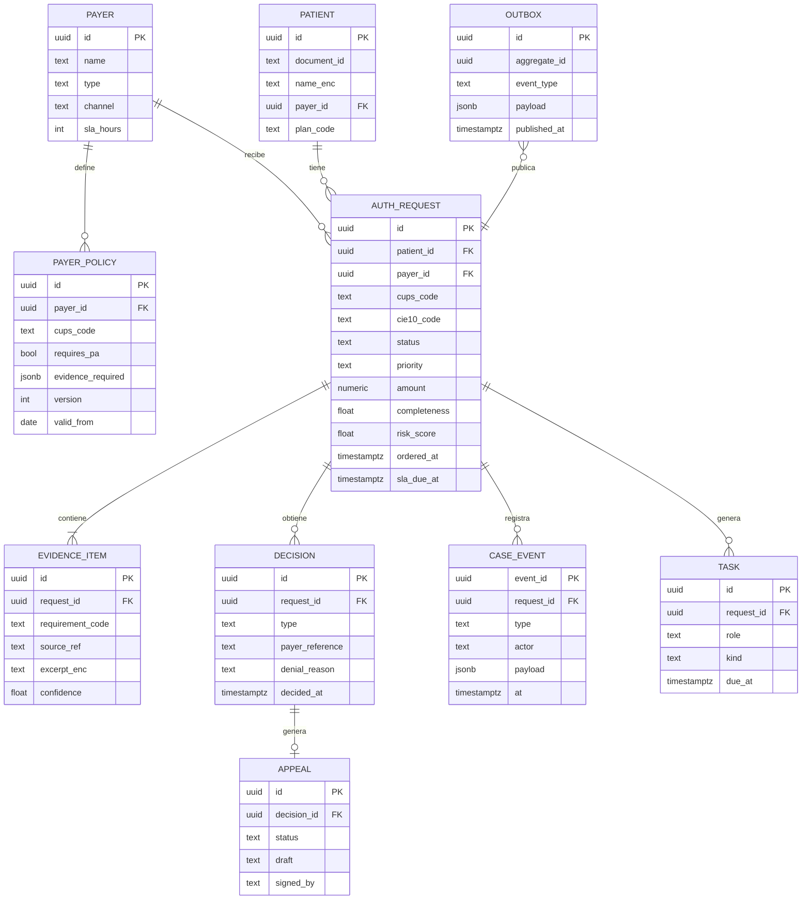
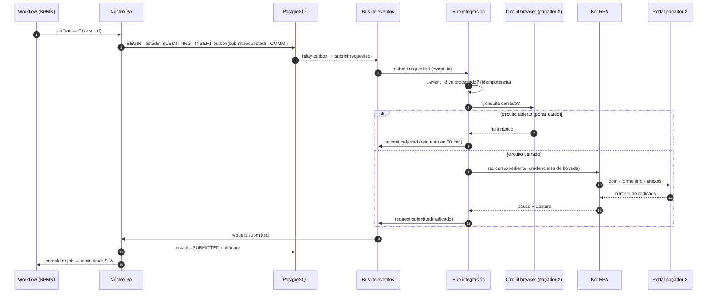
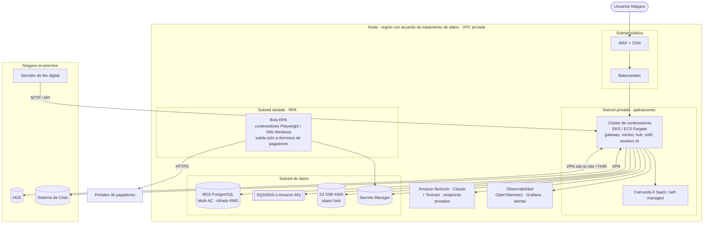

# 04 · Arquitectura técnica — Plataforma "Niágara Autoriza"

> Elaborada con la skill [arquitectura-de-software](https://github.com/jairoamayac/arquitectura-de-software): diagnóstico primero, estilo según atributos de calidad, documentación C4 por niveles, patrones con sus 4 elementos (nombre, problema, solución, consecuencias). Decisiones registradas en [`adr/`](adr/).

---

## 1. Diagnóstico del sistema actual

| Síntoma de mal diseño | Evidencia en Niágara | Anti-patrón | Corrección |
|---|---|---|---|
| **Rigidez** | Agregar un pagador o cambiar una regla de Prepagada exige reentrenar personas | Conocimiento tribal, *Golden Hammer* (todo en Excel) | Reglas como datos (DMN) + Adapter por pagador |
| **Fragilidad** | Si un coordinador se va (34 %), se pierde cómo funciona un portal | *God Object* humano: una persona = todo el proceso | Workflow explícito, roles por bandeja |
| **Inmovilidad** | El Excel no se puede reutilizar para analítica ni integración | *Big Ball of Mud* (hoja compartida sin modelo) | Modelo de dominio + base de datos transaccional |
| **Viscosidad** | Es más fácil llamar que corregir el proceso | Proceso guiado por la herramienta | BPMN ejecutable + métricas |
| Consistencia | Estado del caso en Excel, portal, WhatsApp y correo a la vez | *Dual write* manual | Fuente única de verdad + Outbox |

## 2. Atributos de calidad (drivers)

| Prioridad | Atributo | Escenario medible |
|---|---|---|
| 1 | **Seguridad y privacidad** | Datos clínicos cifrados en tránsito y reposo; acceso por rol mínimo; 100 % de accesos auditados (Ley 1581/2012, Res. 1995/1999). |
| 2 | **Modificabilidad** | Agregar un pagador nuevo en ≤ 2 semanas sin tocar el núcleo; cambiar una regla en ≤ 1 día sin despliegue. |
| 3 | **Resiliencia / disponibilidad** | Caída del portal de un pagador no afecta a los otros 13; 99,5 % disponibilidad hábil. |
| 4 | **Trazabilidad** | Reconstruir la historia completa de cualquier caso (quién, qué, cuándo, con qué evidencia). |
| 5 | **Interoperabilidad** | HL7 FHIR R4 con la HCE; formatos de cada pagador vía adaptadores. |
| 6 | **Rendimiento** | Elegibilidad < 2 min; expediente < 5 min; tablero < 2 s. Volumen bajo (~2.400/mes, picos 200/día). |
| 7 | **Explicabilidad de la IA** | Toda salida de IA cita su fuente; ninguna decisión clínica final sin humano. |

## 3. Decisión de estilo arquitectónico

**Volumen bajo (≈ 110 solicitudes/día) + equipo de TI pequeño ⇒ NO microservicios por defecto.**

Se elige un **monolito modular hexagonal** (núcleo de dominio) + **motor de workflow BPMN** + **un servicio separado de integración con pagadores**, comunicados por **eventos**:

| Pieza | Estilo | Por qué |
|---|---|---|
| Núcleo PA | Monolito modular en capas / hexagonal | Un solo despliegue, transacciones locales, fácil de operar. Módulos con bajo acoplamiento listos para extraer si algún día se necesita. |
| Orquestación | Saga orquestada por motor BPMN | El proceso *es* un BPMN: timers SLA, tareas humanas, compensaciones. |
| Hub de integración con pagadores | Servicio independiente + Pipes & Filters | Perfil de falla distinto (portales caídos, bots RPA lentos); se aísla para que no tumbe el núcleo (*bulkhead*). Escala y se despliega aparte cuando un pagador cambia. |
| Pipeline documental IA | Pipes & Filters asíncrono | OCR → extracción → mapeo → validación son filtros independientes. |
| Comunicación | Event-Driven (pub/sub) + Outbox | Desacopla núcleo, hub, analítica y notificaciones. |
| Lectura / tableros | CQRS ligero (vistas materializadas) | Los KPIs no deben competir con la escritura transaccional. |

Ver [ADR-001](adr/ADR-001-estilo-arquitectonico.md).

---

## 4. C4 — Nivel 1: Contexto

## 5. C4 — Nivel 2: Contenedores

| Contenedor | Responsabilidad | Tecnología propuesta |
|---|---|---|
| Web App | Bandejas por rol, detalle del caso, tablero, simulador | React + TypeScript (el MVP de este repo) |
| App SMART on FHIR | Checklist dentro de la HCE al momento de ordenar | React embebido, OAuth2 SMART |
| API Gateway / BFF | Entrada única, OIDC, auditoría de acceso, límites | Kong / AWS API Gateway |
| Núcleo PA | Dominio: casos, reglas, expediente, negaciones, apelaciones | Spring Boot (Kotlin) o NestJS, arquitectura hexagonal |
| Motor de workflow | Ejecuta BPMN TO-BE, DMN de reglas, timers SLA, tareas humanas | Camunda 8 (o Temporal) |
| Pipeline documental IA | OCR de fax, extracción de evidencia con citas, borradores de apelación | Python workers, Amazon Textract, Claude vía Amazon Bedrock |
| Hub de integración | Un adaptador por pagador, circuit breaker, idempotencia, orquesta bots | Servicio aparte (TS/Python) |
| Granja RPA | Navega portales sin API, radica, consulta estado | Playwright en contenedores / UiPath |
| Notificaciones | Paciente y médico | WhatsApp Business API, SMS |
| Bus de eventos | Pub/sub entre contenedores | RabbitMQ o SQS/SNS (volumen bajo: Kafka es excesivo) |
| PostgreSQL | Fuente única de verdad, outbox, bitácora | RDS PostgreSQL con RLS por sede |
| Objetos | Documentos clínicos y acuses | S3 con SSE-KMS, *object lock* para auditoría |
| Data warehouse | KPIs, entrenamiento de modelos | Redshift / BigQuery / Postgres analítico |
| Bóveda de secretos | Credenciales de 10 portales | AWS Secrets Manager / HashiCorp Vault, rotación |

## 6. C4 — Nivel 3: Componentes del Núcleo PA

Regla de dependencia (hexagonal): **el dominio no depende de nada externo**; la aplicación depende del dominio y de *puertos* (interfaces); los adaptadores implementan los puertos (Inversión de Dependencias).

## 7. C4 — Nivel 4: Modelo de dominio (diagrama de clases)

### 7.1 Máquina de estados del caso (patrón State)

### 7.2 Modelo de datos (ER)

## 8. Secuencia — Radicación con un pagador sin API (RPA)

## 9. Despliegue

**Seguridad:** SSO corporativo (OIDC) + MFA; RBAC por rol (médico, gestor, líder, auditor); cifrado KMS; datos clínicos nunca usados para entrenar modelos del proveedor de IA (endpoints privados, sin retención); bitácora inmutable de acceso; bots RPA con credenciales rotadas en bóveda y egress restringido.

---

## 10. Patrones aplicados (4 elementos)

### 10.1 Patrones GoF / GRASP

| Patrón | Problema | Solución en Niágara Autoriza | Consecuencias |
|---|---|---|---|
| **Adapter** (GoF estructural) | 14 pagadores con interfaces incompatibles (API, portal, WhatsApp, fax) | Interfaz `PayerAdapter` con `ApiPayerAdapter`, `RpaPayerAdapter`, `WhatsAppPayerAdapter` | ✅ El núcleo habla un solo idioma; nuevo pagador = nuevo adaptador. ⚠️ Un adaptador por pagador que mantener. |
| **Factory Method** | Elegir el adaptador correcto según el pagador y su canal | `PayerAdapterFactory.forPayer(id)` lee la configuración del pagador | ✅ Creación centralizada, sin `if` dispersos. |
| **Strategy** | Distintos algoritmos de riesgo/necesidad por tipo de servicio o pagador | `RiskScorer` intercambiable (`RuleBasedScorer`, `MLScorer`) | ✅ A/B de modelos; fallback a reglas si el modelo falla. |
| **State** | El caso cambia de comportamiento según su estado (11 estados) | `AuthorizationRequest` con transiciones válidas explícitas (§7.1) | ✅ Imposible radicar sin expediente completo. ⚠️ Más clases/transiciones que mantener. |
| **Chain of Responsibility** / Pipes & Filters | Pipeline documental con pasos opcionales | Filtros OCR → extracción → mapeo → validación encadenados | ✅ Agregar un filtro no rompe los demás. |
| **Template Method** | Todos los bots RPA siguen login → navegar → llenar → adjuntar → acuse | Clase base `PortalBot` con pasos abstractos por portal | ✅ Reutiliza manejo de errores, capturas y reintentos. |
| **Observer** (pub/sub) | Varios interesados en cada cambio (notificaciones, KPIs, auditoría) | Eventos de dominio publicados al bus | ✅ Bajo acoplamiento. ⚠️ Consistencia eventual. |
| **Facade** | La UI no debe conocer 6 casos de uso para mostrar un caso | BFF expone `GET /cases/{id}` compuesto | ✅ UI simple. |
| **GRASP Experto** | ¿Quién calcula la completitud? ¿y el valor esperado de apelar? | `ClinicalDossier.completeness()`, `Denial.expectedValue()` — tienen la información | ✅ Evita *Anemic Domain Model*. |
| **GRASP Controlador** | ¿Quién recibe los eventos del sistema? | Casos de uso (`RadicarSolicitud`…) coordinan, no los controladores REST | ✅ Lógica de aplicación testeable sin HTTP. |
| **GRASP Indirección** + Inversión de dependencias | El dominio no debe depender de la HCE ni de los pagadores | Puertos `PayerGateway`, `DocumentAI`, `ClinicalRecord` | ✅ Pruebas con *mocks*; cambiar de proveedor de IA sin tocar el dominio. |

### 10.2 Patrones distribuidos

| Patrón | Problema | Aplicación | Consecuencias |
|---|---|---|---|
| **Saga orquestada** | El proceso cruza núcleo, IA, hub, pagador y agenda sin transacción ACID | El motor BPMN orquesta; compensaciones: si la agenda falla tras aprobación → reintento + tarea humana; si se cancela la orden → anular radicado | ✅ Visible y auditable en el modelador. ⚠️ Dependencia del motor. |
| **Outbox** | Guardar estado y publicar evento sin *dual write* | Tabla `outbox` en la misma transacción; *relay* publica al bus | ✅ Nunca hay un caso "radicado" sin evento. |
| **Idempotent Consumer** | Reentregas del bus podrían radicar dos veces ante el pagador | Registro de `event_id` procesados + `idempotency_key` hacia el pagador | ✅ Crítico: una doble radicación genera rechazos. |
| **Circuit Breaker + Retry con backoff + Bulkhead** | Portales caídos o lentos (comunes) | Un circuito y un pool de bots **por pagador** | ✅ La caída de un pagador no afecta a los demás. |
| **Timeout + Fallback** | LLM u OCR lentos | Timeout 30 s; fallback a tarea humana de validación | ✅ El proceso nunca se bloquea por la IA. |
| **CQRS ligero** | Tablero de KPIs pesado | Vistas materializadas/DW alimentados por eventos | ✅ Lecturas rápidas. ⚠️ Retardo de segundos. |
| **Event log (auditoría)** | Trazabilidad legal (tutelas, auditorías del pagador) | `CASE_EVENT` inmutable por caso (sin *event sourcing* completo: no se justifica) | ✅ Historia completa a bajo costo. |
| **Strangler Fig** | Migrar desde el Excel y el trabajo manual sin "big bang" | Pagador por pagador: primero los 4 integrados, luego los de mayor volumen vía RPA | ✅ Riesgo controlado, valor temprano. |
| **API Gateway / BFF** | Dos clientes distintos (web de gestores y app SMART en HCE) | Un BFF por cliente detrás del gateway | ✅ Cada UI recibe lo que necesita. |

### 10.3 Uso de IA: dónde y con qué controles

| Uso | Modelo | Control de calidad |
|---|---|---|
| Fax → solicitud estructurada | OCR + LLM con *structured output* | Validación de esquema y catálogos; confianza < 0,9 → humano |
| Evidencia HCE → checklist | LLM con recuperación (RAG) sobre documentos del paciente | Cada ítem cita documento y fragmento; el gestor ve la fuente |
| Riesgo de negación / revocación | Modelo tabular explicable (regresión logística / árboles) | Métricas mensuales, revisión de sesgo por pagador/sede |
| Borrador de apelación | LLM | Solo cita evidencia del expediente; firma humana obligatoria |
| Clasificación de motivo de negación | LLM + catálogo cerrado | Muestreo de calidad 5 % |

---

## 11. Mapeo con el MVP de este repositorio

El MVP (`/app`) implementa el núcleo de dominio en el navegador para validar la experiencia y las reglas:

| Concepto | Archivo del MVP |
|---|---|
| Agregado + máquina de estados | `app/src/domain/stateMachine.ts` |
| Reglas por pagador (DMN simplificado) + checklist | `app/src/domain/payers.ts` |
| Completitud del expediente / riesgo (Strategy) | `app/src/domain/scoring.ts` |
| Adaptadores por pagador (Adapter + Factory) simulados | `app/src/domain/payerAdapters.ts` |
| Valor esperado de apelación (Experto) | `app/src/domain/appeals.ts` |
| Modelo de valor (simulador) | `app/src/domain/value.ts` |
| Vistas BPMN | `app/src/pages/Process.tsx` (bpmn-js) |
