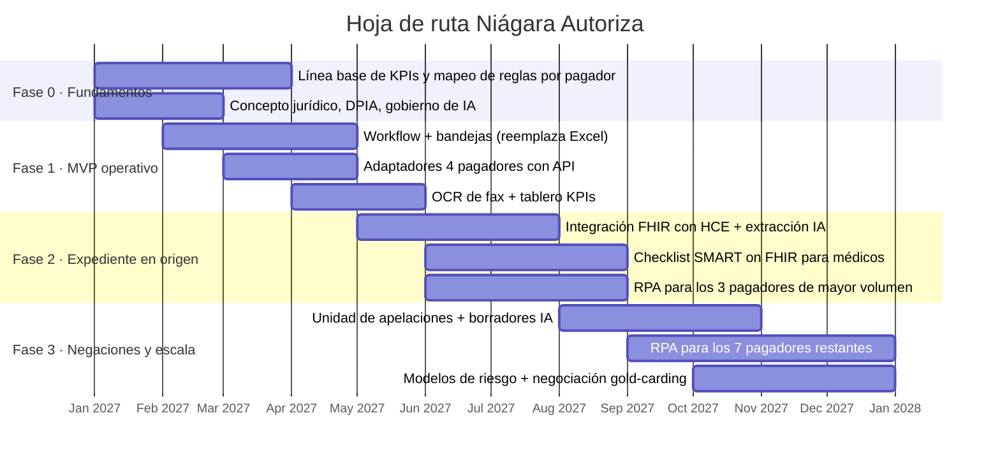

# 05 · Valor, riesgos, consideraciones y hoja de ruta

---

## 1. Valor para la organización (entregable 5)

### 1.1 Ineficiencias y su costo actual

| # | Ineficiencia | Costo anual AS-IS | Palanca del rediseño |
|---|---|---|---|
| I1 | Trabajo sin juicio clínico (61 % del tiempo) | $1,51 M | Automatización de elegibilidad, radicación y seguimiento |
| I2 | Reproceso documental (68 % × 2,3 contactos) | ~$0,86 M (incluido en I1) | Expediente completo en origen con IA |
| I3 | Negaciones perdidas (no apeladas + apelaciones perdidas) | $2,87 M | Menos negaciones + apelación priorizada por valor |
| I4 | Pacientes que abandonan (1.095/año) | $1,10 M | Menos días de espera, autoagenda |
| I5 | Rotación de coordinadores (34 %) | $0,23 M **[S]** | Trabajo de mayor valor, menos sobrecarga |
| | **Total** | **≈ $5,7 M/año** | |

### 1.2 Beneficio esperado (régimen, anual)

Supuestos: $620 por caso autorizado; $1.005 de ingreso por paciente que no abandona; costo cargado de coordinador $120 k **[S]**.

| Beneficio | Conservador | **Base** | Optimista | Cómo se calcula (base) |
|---|---|---|---|---|
| **B1. Capacidad laboral realizada** | $0,36 M (3 coord.) | **$0,60 M** (5 coord.) | $0,72 M (6) | 14 → 9 coordinadores por **no reemplazo** de la rotación (no despidos); 3 se reasignan a una unidad de apelaciones. Además absorbe +7 %/año de volumen sin contratar. |
| **B2. Ingresos por negaciones** | $0,95 M | **$1,49 M** | $1,81 M | Negación 18,4 % → 11 %; apelación 41 % → 85 %; éxito 31 % → 35 %. Pérdida pasa de $2,87 M a $1,38 M. |
| **B3. Ingresos por menor abandono** | $0,38 M | **$0,67 M** | $0,81 M | Abandono 3,8 % → 1,5 % = **662 pacientes más atendidos/año** × $1.005 |
| **B4. Menor rotación** | $0,05 M | **$0,09 M** | $0,14 M | 34 % → 20 % |
| **Total anual** | **$1,73 M** | **$2,85 M** | **$3,48 M** | |

| Escenario | Negación inicial | % apelado | Éxito apelación | Abandono |
|---|---|---|---|---|
| Conservador | 14 % | 70 % | 33 % | 2,5 % |
| Base | 11 % | 85 % | 35 % | 1,5 % |
| Optimista | 9 % (mejor pagador hoy) | 90 % | 38 % | 1,0 % |

> El simulador del MVP (sección **Valor**) reproduce estas fórmulas y permite mover cada supuesto.

### 1.3 Inversión y retorno **[S]**

| Concepto | Año 1 | Años 2+ |
|---|---|---|
| Desarrollo plataforma (equipo de 6, ~9 meses) | $420 k | — |
| Integración HCE (FHIR) + Sistema de Citas | $80 k | — |
| Licencias (workflow, RPA) + infraestructura nube | $120 k | $120 k |
| IA (OCR + LLM): ~28.800 casos × ~$0,50 | $15 k | $15 k |
| Equipo de plataforma en operación (2 FTE) | — | $130 k |
| Gestión del cambio y capacitación | $50 k | $10 k |
| **Total** | **≈ $685 k** | **≈ $275 k/año** |

| | Año 1 (rampa 40 %) | Año 2 | Año 3 | Acumulado 3 años |
|---|---|---|---|---|
| Beneficio (base) | $1,14 M | $2,85 M | $2,85 M | $6,84 M |
| Costo | $0,69 M | $0,28 M | $0,28 M | $1,24 M |
| **Neto** | **+$0,45 M** | **+$2,57 M** | **+$2,57 M** | **+$5,60 M** |

**Retorno ≈ 4,5× la inversión en 3 años; recuperación en ~9–12 meses.** Incluso el escenario conservador ($1,73 M/año) recupera la inversión en el segundo año.

### 1.4 Alineación con el plan estratégico

| Objetivo estratégico | Contribución |
|---|---|
| Reducir costos operativos no clínicos 12 % | B1 = **−24 % del costo del equipo PA** ($0,60 M / $2,48 M) |
| Ampliar capacidad de especialistas sin crecimiento administrativo proporcional | El volumen puede crecer +40 % con el mismo equipo (costo marginal por caso ≈ IA + infraestructura) |
| Mejorar el acceso del paciente | Espera 6,1 → ≤ 2,5 días; +662 pacientes/año atendidos |
| Modernizar la infraestructura tecnológica | Plataforma FHIR + eventos + datos, reutilizable para facturación, glosas y referencia |
| Experiencia del paciente (ligada a compensación médica) | Menos espera y abandono → mejores puntajes |

---

## 2. Riesgos y qué validar (entregable 6)

| # | Riesgo | Prob. | Impacto | Mitigación | Qué validar antes de escalar |
|---|---|---|---|---|---|
| R1 | **Error de la IA** (evidencia mal extraída, apelación con datos inexactos) | Media | Alto | Citas obligatorias a la fuente, umbral de confianza, firma humana (ADR-003), regresión de prompts | Precisión de extracción ≥ 95 % sobre 200 expedientes reales anonimizados |
| R2 | **Privacidad / cumplimiento** (datos sensibles en la nube y en un LLM) | Media | Muy alto | Ley 1581/2012: autorización y finalidad; transferencia a proveedor con contrato de transmisión; cifrado; sin retención; DPIA | Concepto jurídico y del oficial de protección de datos; revisión de seguridad |
| R3 | **Bots RPA se rompen** por cambios en portales; pagadores pueden prohibir automatización en sus términos | Alta | Medio | Pruebas de contrato diarias, circuit breaker, fallback humano; negociar canal oficial | Revisar términos de uso de cada portal; piloto con 2 pagadores de alto volumen |
| R4 | **Adopción médica** baja (no completan faltantes en la HCE) | Media | Alto | Checklist dentro de la HCE, 1 clic, texto sugerido; métricas por médico; líderes clínicos | Prueba de usabilidad con 10 médicos; tiempo de completitud < 2 min |
| R5 | **Calidad de la HCE** insuficiente (notas no estructuradas, consultas sin HCE) | Media | Alto | OCR + IA; plan de digitalización de las consultas que aún usan fax | Medir % de evidencia encontrable automáticamente por CUPS |
| R6 | **Resistencia del equipo PA** (miedo a perder el empleo) | Alta | Medio | Mensaje explícito: sin despidos, reducción por rotación natural; nuevos roles (gestor clínico, apelaciones, analista de reglas) | Plan de RR. HH. aprobado antes de anunciar |
| R7 | **Supuestos financieros** (monto $620, éxito de apelación ≥ 35 %) no se cumplen | Media | Medio | Escenario conservador sigue siendo positivo; medir mensualmente | Línea base real de 3 meses antes del piloto |
| R8 | **Sesgo del modelo de riesgo** (priorizar apelaciones según pagador/población y descuidar Sisbén) | Baja | Alto | Umbral de apelación también por urgencia clínica, no solo $; auditoría de equidad | Análisis de impacto por tipo de pagador |
| R9 | **Dependencia de proveedores** (motor BPMN, LLM) | Baja | Medio | Puertos/adaptadores (hexagonal), BPMN estándar, LLM intercambiable | Prueba de portabilidad del modelo BPMN |
| R10 | **Integración con la HCE** más lenta de lo previsto | Media | Alto | Empezar con lectura FHIR; SMART on FHIR en fase 2 | Inventario de APIs disponibles del proveedor de HCE |

---

## 3. Consideraciones para la dirección (entregable 7)

1. **Esto es un rediseño de proceso, no una compra de herramienta.** Si se automatiza el proceso actual (RPA sobre el Excel), se automatiza el desperdicio. El cambio clave es **mover la calidad del expediente al momento de la orden médica**.
2. **Decidir el destino de la capacidad liberada antes de implementar.** Recomendación: reducir por rotación natural (34 % hace que en ~12 meses salgan ~5 personas sin despidos) y crear una **unidad de apelaciones** de 3 personas. Comunicarlo desde el día uno.
3. **Gobernanza de reglas de pagadores.** Crear el rol de *analista de políticas de pagadores* dueño del DMN. Sin dueño, las reglas se desactualizan y el sistema pierde valor.
4. **Gobernanza clínica de la IA.** Un comité (dirección médica + jurídica + TI) aprueba los usos de IA, revisa métricas de calidad trimestralmente y define qué nunca se automatiza.
5. **Negociación con pagadores.** Usar los datos nuevos (tasa de aprobación por médico/CUPS) para negociar **APIs oficiales, ventanillas digitales y gold-carding** (exención de PA a médicos con > 90 % de aprobación). Es la palanca de largo plazo más grande: la mejor autorización es la que no hace falta.
6. **Ética de la priorización.** El valor esperado ($) no puede ser el único criterio para apelar: la urgencia clínica y la equidad (Sisbén) deben pesar igual.
7. **Medir la línea base antes de empezar.** Los datos del caso tienen inconsistencias (ver [01 §2.1](01-analisis-caso.md)); 3 meses de medición real evitan prometer beneficios que no se puedan demostrar.
8. **Gestión del cambio con los médicos.** Su satisfacción (3,8/10) y su compensación están ligadas al acceso del paciente: presentar el sistema como *"menos llamadas, pacientes atendidos antes"*.
9. **Implementación incremental (Strangler Fig), no big bang.**

---

## 4. Hoja de ruta

| Fase | Hito de valor | Criterio de salida |
|---|---|---|
| 0 | Línea base confiable | KPIs medidos 3 meses; reglas de 14 pagadores documentadas |
| 1 | Adiós Excel; visibilidad total | 100 % de casos en el workflow; tablero en uso |
| 2 | Fin de las llamadas por documentos | Seguimiento documental ≤ 25 %; tiempo por caso ≤ 1,5 h |
| 3 | Negaciones como inventario | ≥ 80 % negaciones evaluables apeladas; metas TO-BE completas |
